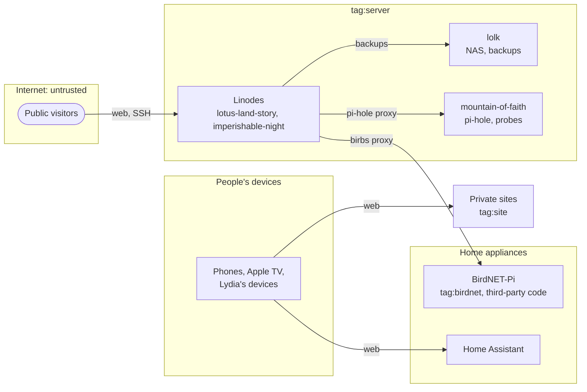

# Tailnet access

This is the threat model for the tailnet, and the plan for narrowing its
policy. The policy is `tailscale_acl.policy` in [`main.tf`](../main.tf).
Update this document as each rollout step lands.

Today every member device and every `tag:server` node reaches every port
on every node, except hopeless-masquerade (`tag:birdnet`). The goal is
that a compromised device or server reaches only what it legitimately
uses.

## Assets

The tailnet protects the following, roughly most valuable first:

- The restic repository on legacy-of-lunatic-kingdom (lolk), which holds
  every server's backups.
- Secrets on the servers: sops-decrypted credentials, API tokens, and
  database contents.
- Home Assistant, which controls the physical home.
- Personal data in the services: Syncthing folders, feeds, contacts, and
  the fediverse account.
- The tailnet policy itself, which the tofu OAuth client can rewrite.

## Zones and flows

The following diagram shows the trust zones and the connections that
carry data or control between them under the target policy. Arrows point
from the side that opens the connection. Two kinds of traffic are left
out to keep it readable: your Mac, which reaches everything, and
monitoring and DNS. For monitoring, the Linodes scrape every node, every
node ships logs to the Linodes, and mountain-of-faith probes the private
sites. For DNS, everything resolves through pi-hole on mountain-of-faith.

Public visitors reach only the Linodes, so a public attack lands there
first. Anything it does next has to cross the tailnet, which is what the
policy controls. The most valuable crossing is the Linodes' restic
backups to lolk. Private sites run inside Caddy on the Linodes and open
no connections of their own. Exit-node traffic from people's devices
leaves for the internet and isn't drawn.

## Footholds

The following table lists where an attacker could gain a foothold, what
it can reach today, and what it could reach under the target policy:

| Foothold | How | Reaches today | Reaches in the target | Status |
|---|---|---|---|---|
| BirdNET-Pi | Its third-party installer or web UI | VictoriaLogs ingestion and pi-hole DNS | Same | Mitigated |
| Phone, Apple TV, or Lydia's device | Lost, stolen, or compromised | Every port on every node | Private sites, Home Assistant, DNS, and exit nodes | Addressable |
| Linode | A public site or a container image | Every port on every node, and deleting every backup | Server ports on every server, and deleting every backup | Addressable |
| lolk | A container or Syncthing | Every port on every node, plus the restic repository it holds | Server ports on every server, plus the restic repository | Addressable |
| mountain-of-faith | A service such as pi-hole | Every port on every node | Server ports on every server | Addressable |
| Your Mac | Compromise of the admin machine | Everything | Everything | Open |
| tofu OAuth client | Leaked credentials | Rewriting the policy | Same | Mitigated |

Mitigated means the attack fails unless an assumption below breaks.
Addressable means a fix exists but hasn't landed. The rollout below
narrows the device and server rows, and an append-only repository on lolk
removes backup deletion. Open means the risk is accepted.

Two findings make the Linode row the worst one:

- The entry point has the most reach. The Linodes take all public
  traffic, and they're also the monitoring hub, the source of every
  proxy into the home network, and the backup clients. The monitoring
  reach is only to read-only metrics ports, so it matters less than the
  backups below. Push-based collection would remove it, but needs an
  agent on every host and still needs a scraper for pull-only endpoints.
- The backup clients can destroy the backups. lolk's `restic` user is
  confined to SFTP, but SFTP can delete, and both Linodes back up to one
  shared repository as that user and prune it themselves. A compromised
  Linode can delete or read every server's backups, and no offsite copy
  exists yet. An append-only rest-server on lolk, with pruning run on
  lolk, would close this.

The server rows also stay broad because servers share one tag: grants
limit which ports a server reaches, not which host.

## Assumptions

The model holds only while these do:

- Tailscale's coordination server and clients enforce the policy as
  documented.
- Tagging a device removes its user, so tagged servers stop matching
  `autogroup:member`. The Tailscale tags docs state this.
- The packet filter allows return traffic on an allowed connection.
  Tagging hopeless-masquerade confirmed it: birbs, its scrape, and its
  logs kept working.
- Your Mac is trusted. It's the one device with full access.
- The tofu OAuth client's credentials stay in 1Password.

## Not addressed

The tailnet policy doesn't cover the following:

- Anything on the home LAN. A compromised device there reaches whatever
  home services listen on the LAN, such as pi-hole, without
  touching the tailnet.
- Vulnerabilities in the public services themselves. Patching handles
  those, not the policy.
- A compromise of Tailscale.

## Target policy

The target policy identifies devices as follows:

| Group | Who | Identified by |
|---|---|---|
| Your Mac | The owner's macOS devices | `autogroup:owner` plus `posture:mac` (`node:os` is `macos`) |
| Other member devices | Your phones and Apple TV, Lydia's devices | `autogroup:member` |
| Servers | lotus-land-story, lolk, imperishable-night, mountain-of-faith | `tag:server` |
| Sites | The nodes caddy-tailscale registers per private site | `tag:site` |
| BirdNET-Pi | hopeless-masquerade | `tag:birdnet` |
| Home Assistant | home-assistant-5119 | Not decided |

Devices that report no OS fail `posture:mac` rather than pass it.

Public visitors reach the cloud servers on 80 and 443. lotus-land-story
also opens SSH publicly so the work laptop can push to quire;
imperishable-night's SSH is tailnet-only.

Servers reach each other on the following ports:

| Port | Use |
|---|---|
| 22 | restic over SFTP to lolk |
| 53 | pi-hole DNS on mountain-of-faith |
| 80 | Caddy proxying to pi-hole |
| 2019 | Caddy metrics |
| 8080 | cadvisor |
| 8384 | Syncthing metrics |
| 9100 | node-exporter |
| 9115 | blackbox-exporter on mountain-of-faith |
| 9428 | VictoriaLogs ingestion |
| 10009 | Prusa exporter |

A future grant would let your phone reach Rex on your Mac, from the owner
with an iOS posture.

## Rollout

Each step can be rolled back, and access only narrows in the last one:

1. Remove the dead nodes in the Tailscale console, such as caddytest,
   caddytest-proxy, home-assistant, and homeassistant-509.
2. Add the target grants and `tests` alongside the current allow-all
   rule.
3. Tag the servers `tag:server` with `tailscale_device_tags`, one host at
   a time, and check scrapes, backups, and logs after each.
4. Mint the Caddy auth key with `tag:site`, and retag the site nodes.
   lotus-land-story's site nodes are user-owned, so they need retagging
   or replacing when their services move.
5. Replace the members' allow-all rule with the owner grant and the
   narrower member grants.

## Open questions

- What does Home Assistant connect out to, and which tag fits it? It
  also offers an exit node.
- Does double-dealing-character, the travel router, route traffic for
  other devices?
- Do Syncthing peers sync over the tailnet (port 22000) or the LAN?
